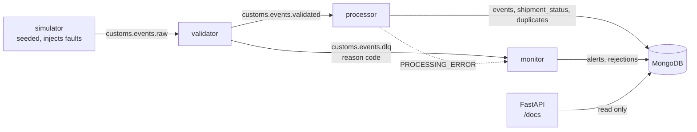

# Customs Clearance Event Pipeline

> **Synthetic data.** Every event is generated by a simulator. The formats are real (ISO 6346 container IDs with check
> digits, UN/LOCODE ports, 6-digit HS codes); the shipments are not.

An event-driven pipeline that works out each shipment's current customs clearance state from an immutable event log.
It tolerates duplicate, late, out-of-order, malformed and illegal events, sends unprocessable ones to a dead-letter topic
with a reason code, alerts on shipments held too long, and serves everything through a read-only API.

**Status:** Release 1 (P0–P10) is built and verified locally, including every service running as a container. The GitHub
Actions workflow is written but has **not run yet** (it runs on the first push). Kubernetes is **planned** (see [Planned](#planned)).
Progress: [docs/TASKS.md](docs/TASKS.md).

## How it works



- **validator:** schema (strict Pydantic), ISO 6346 check digit, and reference-data checks, in that order. Bad events go to the
  DLQ as `SCHEMA_INVALID`, `CONTAINER_ID_INVALID` or `UNKNOWN_REFERENCE_DATA`. It does not deduplicate.
- **processor:** stores each event once (unique `event_id`), then re-derives the shipment's state by folding **all** of its events
  in event-time order. Arrival order therefore does not matter: a late event heals an earlier anomaly. Status writes are guarded,
  so an older computation never overwrites a newer one.
- **monitor:** one alert per hold longer than `HOLD_ALERT_SECONDS` (a unique index makes it idempotent), and a DLQ sink into `rejections`.
- **api:** shipments (with a `state` filter), event history in fold order, anomalies, alerts, rejection counts by reason, and pipeline stats.

Delivery is at-least-once (idempotent producer, manual commits after the write succeeds). Processing is idempotent and
deterministic, so the **effect** on stored state is the same as processing each event once. Kafka transactions are not used.

## Run the verified demo

Prerequisites: Windows with Docker Desktop (its disk image on D:), and [uv](https://docs.astral.sh/uv/).

```powershell
. .\scripts\dev-env.ps1                    # session-only env: caches, temp and Docker config on D:
uv python install 3.11 --no-bin
uv venv --python 3.11 .venv
. .\scripts\dev-env.ps1                    # again, to activate the venv
uv pip install -e .[dev]
Copy-Item .env.example .env                # then set MONGO_PASSWORD
docker compose --env-file .env -f deploy/compose/docker-compose.yml up -d --wait
python -m ccp.common.topics                # idempotent: creates raw (6), validated (6), dlq (1)
python -m ccp.demo --seed 42
```

The demo starts validator, processor, monitor and api, runs the simulator, then compares the API's results with the
simulator's own expected-outcome manifest (`python -m ccp.simulator --seed 42 --expect`). It exits 0 only on an exact match.
A recorded run (2026-10-14, about 72 s):

```text
                                              expected    actual
produced (= stored + duplicates + rejected)         69        69
events stored                                       62        62
duplicates dropped                                   1         1
anomalies                                            1         1
hold alerts                                          2         2
DLQ CONTAINER_ID_INVALID                             2         2
DLQ PROCESSING_ERROR                                 0         0
DLQ SCHEMA_INVALID                                   4         4
DLQ UNKNOWN_REFERENCE_DATA                           0         0
state CLEARED                                        6         6
state DOCS_VERIFIED                                  1         1
state FILED                                          2         2
state ON_HOLD                                        2         2
state REJECTED                                       4         4
state RELEASED                                       4         4
state UNKNOWN                                        1         1

RESULT: MATCH
```

Explore afterwards: `$env:MONGO_DB="ccp_demo"; python -m ccp.api`, then open http://127.0.0.1:8000/docs.
Kafka UI (optional): add `--profile ui` to the `up` command and open http://127.0.0.1:8080.

## What is verified

| Claim | Evidence |
|---|---|
| Every arrival order of a lifecycle gives the same state | `tests/test_fold.py` (all permutations, every state × event pair) |
| Replaying the stream changes nothing; shuffled orders converge | `tests/integration/test_processor.py` |
| A hard-killed processor heals after restart; crash replays are not counted as duplicates | `test_killed_processor_heals_after_restart` |
| MongoDB down or hung: the processor waits, keeps its heartbeat fresh, and resumes | `test_processor_waits_for_mongo_at_startup`, `test_mongo_hung_mid_run_...` |
| One alert per hold across monitor restarts; DLQ replay never double-counts | `tests/integration/test_monitor.py` |
| Bad events land in the DLQ with the right reason | `tests/integration/test_validator.py` |
| End to end, the pipeline matches the manifest exactly | `python -m ccp.demo --seed 42`, `tests/integration/test_smoke.py` |

Each fix in Phase 6 was mutation-checked (the fix was reverted and its test had to fail); see
[docs/DECISIONS.md](docs/DECISIONS.md), "Phase 6 limit fixes".

```powershell
pytest -q                                              # unit tests, no infrastructure
$env:CCP_INTEGRATION="1"; pytest -q -m integration     # needs the Compose stack
```

### Everything in containers

```powershell
docker build -t ccp:0.1.0 .                                                   # one image, 268 MB
docker compose --env-file .env -f deploy/compose/docker-compose.yml --profile app up -d --wait
docker compose --env-file .env -f deploy/compose/docker-compose.yml run --rm simulator --seed 42
python -m ccp.demo --seed 42 --verify-only                                   # RESULT: MATCH (recorded 2026-10-14)
```

Use a fresh stack for `--verify-only` (`down` first): it counts everything in the database.

## Known limits

Listed in [TRD §17](docs/TRD.md#17-known-limits). The main ones: source clock skew is not corrected; the same logical event re-sent
with a new `event_id` is not detected; single broker and single MongoDB node (no high availability); the API has no authentication;
each event re-reads its shipment's history (measured: 6 ms per event at 10 events, 59 ms at 5,000).

## Planned

Not built yet (Release 2, P11–P12): Kubernetes manifests on kind with the processor scaled to 3 replicas, and the final polish.
CI is written but unproven until it runs. Add-ons are listed in
[IMPLEMENTATION_PLAN.md](docs/IMPLEMENTATION_PLAN.md).

Design docs: [PRD](docs/PRD.md) · [TRD](docs/TRD.md) · [Architecture](docs/ARCHITECTURE.md) · [Plan](docs/IMPLEMENTATION_PLAN.md) · [Decisions](docs/DECISIONS.md)
