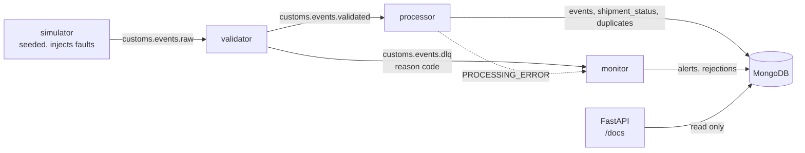
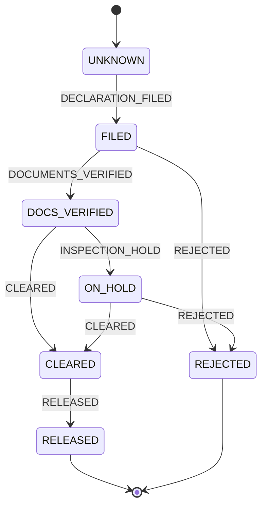
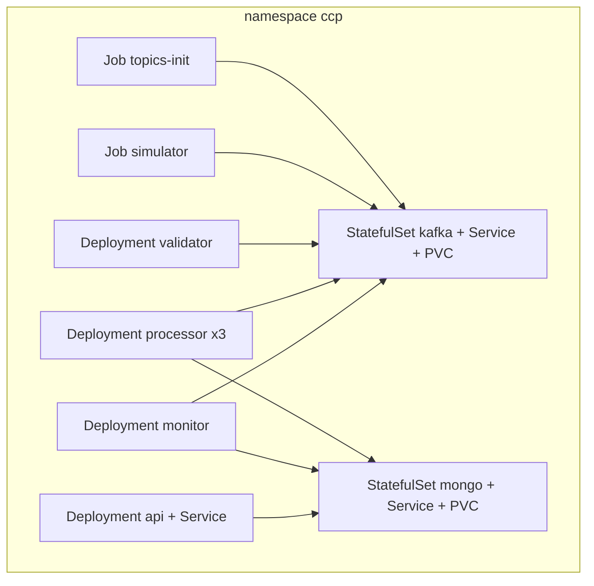

# Customs Clearance Event Pipeline

> **Synthetic data.** Every event is generated by a simulator. The formats are real (ISO 6346 container IDs with check
> digits, UN/LOCODE ports, 6-digit HS codes); the shipments are not.

An event-driven pipeline that works out each shipment's current customs clearance state from an immutable event log.
It tolerates duplicate, late, out-of-order, malformed and illegal events, sends unprocessable ones to a dead-letter topic
with a reason code, alerts on shipments held too long, and serves everything through a read-only API.

**Status:** built and verified end to end. Release 1 runs every service in Docker Compose with CI (lint and unit tests, the
Compose integration suite, the containerised demo). Release 2 runs the same image on Kubernetes (kind): the demo matches
there, the processor rebalances across 3 replicas, and a chaos run under load (pod kills, broker and database restarts,
a liveness restart) keeps every shipment correct. Progress log: [docs/TASKS.md](docs/TASKS.md).

## How it works



- **validator:** schema (strict Pydantic), ISO 6346 check digit, and reference-data checks, in that order. Bad events go to the
  DLQ as `SCHEMA_INVALID`, `CONTAINER_ID_INVALID` or `UNKNOWN_REFERENCE_DATA`. It does not deduplicate.
- **processor:** stores each event once (unique `event_id`), then re-derives the shipment's state by folding **all** of its events
  in event-time order. Arrival order therefore does not matter: a late event heals an earlier anomaly. Status writes are guarded,
  so an older computation never overwrites a newer one.
- **monitor:** one alert per hold longer than `HOLD_ALERT_SECONDS` (a unique index makes it idempotent), closed again when the hold
  ends, and a DLQ sink into `rejections`.
- **api:** shipments (with a `state` filter), event history in fold order, anomalies, alerts, rejection counts by reason, and pipeline stats.

The fold applies these transitions. Any other step is skipped for state purposes and recorded as an `ILLEGAL_TRANSITION` anomaly,
which a later re-fold can heal:



Delivery is at-least-once (idempotent producer, manual commits after the write succeeds). Processing is idempotent and
deterministic, so the **effect** on stored state is the same as processing each event once. Kafka transactions are not used.

## Run the verified demo (Docker Compose)

Prerequisites: Windows with Docker Desktop, and [uv](https://docs.astral.sh/uv/). `dev-env.ps1` keeps caches, temp files and
Docker's client config under `D:\ccp-data` for this machine; on another machine, change `$Data` at its top.

```powershell
. .\scripts\dev-env.ps1                    # session-only env: caches, temp and Docker config on D:
uv python install 3.11 --no-bin
uv venv --python 3.11 .venv
. .\scripts\dev-env.ps1                    # again, to activate the venv
uv pip install -e .[dev]
Copy-Item .env.example .env                # then set MONGO_PASSWORD
docker compose --env-file .env -f deploy/compose/docker-compose.yml up -d --wait
python -m ccp.common.topics                # idempotent: creates raw (6), validated (6), dlq (1)
python -m ccp.demo --seed 42
```

The demo starts validator, processor, monitor and api, runs the simulator, then compares the API's results with the
simulator's own expected-outcome manifest (`python -m ccp.simulator --seed 42 --expect`). It exits 0 only on an exact match.
A recorded run (2026-10-14, 74 s, exit 0):

```text
                                              expected    actual
produced (= stored + duplicates + rejected)         69        69
events stored                                       62        62
duplicates dropped                                   1         1
anomalies                                            1         1
open hold alerts                                     2         2
DLQ CONTAINER_ID_INVALID                             2         2
DLQ PROCESSING_ERROR                                 0         0
DLQ SCHEMA_INVALID                                   4         4
DLQ UNKNOWN_REFERENCE_DATA                           0         0
state CLEARED                                        6         6
state DOCS_VERIFIED                                  1         1
state FILED                                          2         2
state ON_HOLD                                        2         2
state REJECTED                                       4         4
state RELEASED                                       4         4
state UNKNOWN                                        1         1

RESULT: MATCH
```

Explore afterwards: `$env:MONGO_DB="ccp_demo"; python -m ccp.api`, then open http://127.0.0.1:8000/docs.
Kafka UI (optional): add `--profile ui` to the `up` command and open http://127.0.0.1:8080.

### Everything in containers

```powershell
docker build -t ccp:0.1.0 .                                                   # one image, 268 MB
docker compose --env-file .env -f deploy/compose/docker-compose.yml --profile app up -d --wait
docker compose --env-file .env -f deploy/compose/docker-compose.yml run --rm simulator --seed 42
python -m ccp.demo --seed 42 --verify-only                                   # RESULT: MATCH (recorded 2026-10-14)
```

Use a fresh stack for `--verify-only` (`down` first): it counts everything in the database.

## Run on Kubernetes (kind)

The same image, as plain manifests in [deploy/k8s/](deploy/k8s/): Kafka and MongoDB as single-replica StatefulSets with PVCs,
four Deployments, a ConfigMap, a Secret created from `.env` at deploy time, and Jobs for topic creation and the simulator.
Consumers have no HTTP port, so their liveness probe checks a heartbeat file the poll loop touches.



Compose and kind never run together (RAM). The full steps, including the Secret and the chaos check, are in
[deploy/k8s/README.md](deploy/k8s/README.md). In short:

```powershell
kind create cluster --config deploy/k8s/kind-config.yaml
kind load docker-image ccp:0.1.0 --name ccp
# namespace, configmap, secret, kafka, mongo, topics job, the four services (deploy/k8s/README.md, steps 3-4)
kubectl -n ccp port-forward svc/api 8000:8000                                 # in a second terminal
kubectl apply -f deploy/k8s/simulator-job.yaml
python -m ccp.demo --seed 42 --verify-only                                   # RESULT: MATCH on kind
kubectl -n ccp scale deploy/processor --replicas=3                            # rebalance: 2 partitions each
.\scripts\kind-chaos.ps1                                                      # chaos check, exit 0 on success
```

## What is verified

| Claim | Evidence |
|---|---|
| Every arrival order of a lifecycle gives the same state | `tests/test_fold.py` (`test_every_arrival_order_gives_same_result`, every state × event pair) |
| Redelivering the stream changes nothing; shuffled orders converge | `tests/integration/test_processor.py` |
| A hard-killed processor heals after restart; crash replays are not counted as duplicates | `test_killed_processor_heals_after_restart` |
| MongoDB down or hung: the processor waits, keeps its heartbeat fresh, and resumes | `test_processor_waits_for_mongo_at_startup`, `test_mongo_hung_mid_run_...` |
| One alert per hold across monitor restarts, closed when the hold ends; DLQ replay never double-counts | `tests/integration/test_monitor.py`, `tests/test_monitor_resolve.py` |
| Bad events land in the DLQ with the right reason | `tests/integration/test_validator.py`, `tests/test_validator_route.py` |
| End to end, the pipeline matches the manifest exactly | `python -m ccp.demo --seed 42`, `tests/integration/test_smoke.py` |
| The same, fully containerised and in CI | `.github/workflows/ci.yml`, 3 jobs: lint and 166 unit tests, 40 integration tests, image + containerised demo MATCH (latest GitHub run: 4 min 30 s) |
| The demo matches on kind; 3 processors share the 6 partitions, 2 each | [DECISIONS](docs/DECISIONS.md) "P11 results" (rebalance logs, `python -m ccp.common.groups`) |
| Under load and chaos on kind, every shipment stays correct | `scripts/kind-chaos.ps1`: 21,506 messages, validator and processor SIGKILLs, 5 injected re-sends, Kafka and MongoDB restarts mid-backlog, scaling 1 → 3 → 2 → 3; **16/16 totals match and the per-shipment audit finds 0 of 5,997 wrong** ([DECISIONS](docs/DECISIONS.md) "Chaos rerun") |
| A frozen consumer is restarted by its liveness probe | same run: a SIGSTOPped processor restarted 126 s later, then 16/16 and 0 wrong again |

Each fix in Phase 6 and in the later debug rounds was checked red first (the test failed before the fix); see
[docs/DECISIONS.md](docs/DECISIONS.md).

```powershell
pytest -q                                              # unit tests, no infrastructure
$env:CCP_INTEGRATION="1"; pytest -q -m integration     # needs the Compose stack
```

## Known limits

The full list, with measurements, is in [TRD §17](docs/TRD.md#17-known-limits).

- **Clock skew** between sources is not corrected: `occurred_at` is trusted as given.
- **The same logical event re-sent with a new `event_id`** is not detected as a duplicate.
- **No high availability:** one Kafka broker (replication factor 1) and one MongoDB node. The event insert and the status write are
  two writes, not a transaction; a redelivery heals a crash between them.
- **Hold alerts under processing lag:** the monitor compares event time with its own clock, so a backlog reads as hold time. Under
  chaos on kind, a 20 s threshold raised 2,203 alerts for 605 real holds. The false ones close themselves once the clearing event is
  processed (605 stayed open), but they were raised, so anyone paged for them was paged wrongly. The fix is an event-time watermark (add-on).
- **Validator output is at-least-once:** a validator that crashes after sending can re-send an event, which the processor drops
  and counts as a duplicate. The demo accounts for these re-sends; it does not prevent them.
- **Recompute cost** grows with a shipment's history: 6 ms per event at 10 events, 59 ms at 5,000 (measured). Customs lifecycles
  have under 10 events.
- A container ID that changes within a shipment is not detected. Reference data is static (restart to change). Offset pagination
  is slow on deep pages. The API has no authentication. Kafka UI exists in Compose only.
- **No throughput claims:** nothing was load-tested for speed.

## Add-ons (not built)

Listed in [IMPLEMENTATION_PLAN.md](docs/IMPLEMENTATION_PLAN.md#add-on-features-after-the-main-project-works): event-time
watermarking, Prometheus and Grafana, a schema registry, an event replay CLI, a Locust load test, a Helm chart, API auth,
cloud deployment, and a Streamlit dashboard.

Design docs: [PRD](docs/PRD.md) · [TRD](docs/TRD.md) · [Architecture](docs/ARCHITECTURE.md) · [Plan](docs/IMPLEMENTATION_PLAN.md) · [Decisions](docs/DECISIONS.md)
