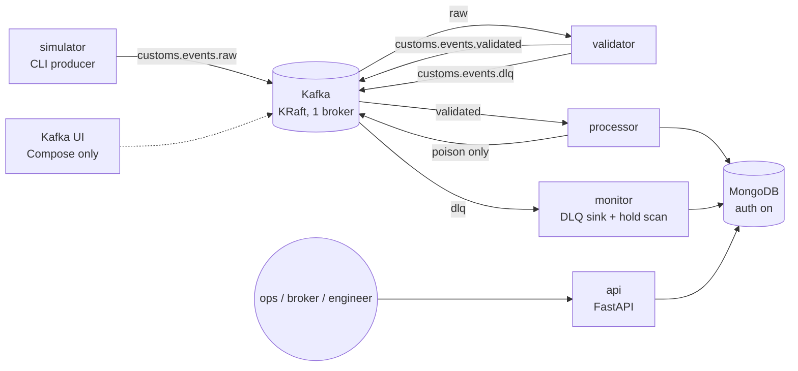
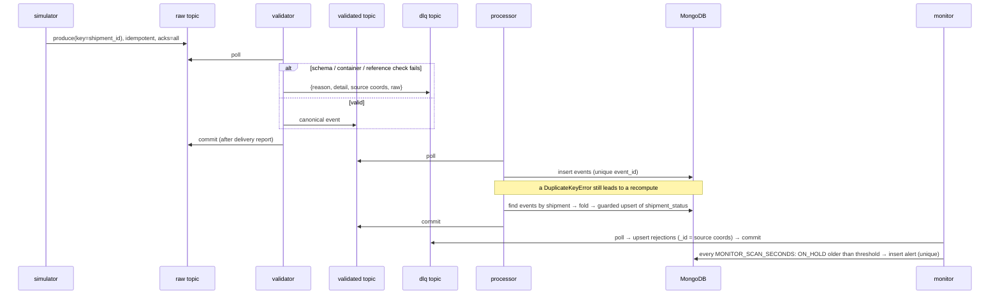
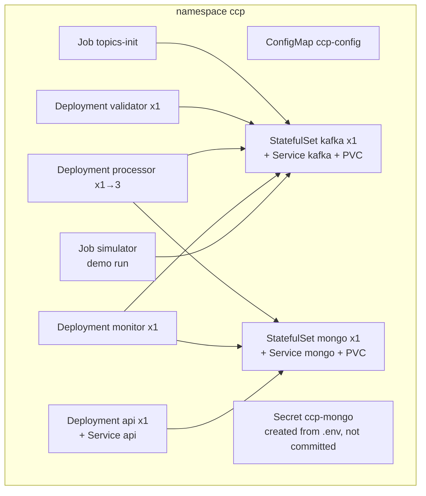

# Architecture: Customs Clearance Event Pipeline

> **Synthetic data.** The contracts, the fold and the failure handling are specified in TRD.md. This file shows how the
> pieces fit and how they are deployed.

## 1. Component diagram

## 2. Data flow (one event, happy path and faults)

## 3. Topic and consumer-group topology

| Topic | Partitions | Written by | Consumer group (service) |
|---|---|---|---|
| `customs.events.raw` | 6 | simulator | `ccp-validator` (validator) |
| `customs.events.validated` | 6 | validator | `ccp-processor` (processor, 1–6 replicas) |
| `customs.events.dlq` | 1 | validator, processor | `ccp-monitor-dlq` (monitor) |

All topics are keyed by `shipment_id`, with RF=1. Topics are created up front by `python -m ccp.common.topics` (an idempotent
AdminClient script), and broker auto-create is turned off so a typo cannot silently create a new topic.

## 4. Service responsibilities

| Service | Does | Does not |
|---|---|---|
| `simulator` | Generates a seeded event stream with faults; `--expect` prints the expected outcomes | Read anything back |
| `validator` | Schema, ISO 6346 and reference checks; routes to `validated` or `dlq` | Deduplicate, or hold durable state |
| `processor` | Stores events, deduplicates, folds, upserts `shipment_status`, counts duplicates | Alert, or write rejections |
| `monitor` | DLQ → `rejections`; hold-too-long → `alerts` | Change shipment state |
| `api` | Read-only queries and `/health` | Write anything |

All five run from **one image** with a different command each (`python -m ccp.<service>`). Pure logic lives in
`ccp.common` (schema, iso6346, refdata, fold) and `ccp.simulator.generate`.

## 5. Kafka listeners (the classic pitfall)

A Kafka client first connects to the bootstrap address, then reconnects to whatever address the broker **advertises**.
If the advertised name cannot be resolved from where the client runs, the connection fails after bootstrap.

| Listener | Bind | Advertised | Used by |
|---|---|---|---|
| `CONTROLLER` | `:9093` | — | KRaft quorum (internal) |
| `INTERNAL` | `:19092` | `kafka:19092` | containers on the Compose network (Kafka UI, and the services after P10) |
| `EXTERNAL` | `:9092` | `localhost:9092` | host venv (P3–P9 dev mode, tests, demo) |

On kind there is a single `PLAINTEXT` listener advertised as `kafka:9092` (the Service name). Nothing outside the
cluster talks to Kafka there: the demo runs the simulator as an in-cluster Job and reads results through the API.

## 6. Compose topology (`deploy/compose/docker-compose.yml`)

| Service | Image (verified 2026-10-11, D-033) | Host port | Memory limit (D-039) | Notes |
|---|---|---|---|---|
| `kafka` | `apache/kafka-native:4.3.1` (fallback `apache/kafka:4.3.1`) | 9092 | 512 MiB | KRaft combined mode, `nc -z` healthcheck, auto-create off, no volume (D-045) |
| `mongo` | `mongo:8.0.32` | 27017 | 512 MiB | root user from `.env`, `--wiredTigerCacheSizeGB 0.25`, named volume |
| `kafka-ui` | `kafbat/kafka-ui:v1.5.0` | 8080 | 512 MiB | `profiles: [ui]` (on demand only); points at `kafka:19092` |
| `topics-init` | `ccp` image (P10) | — | 192 MiB | one-shot, `depends_on: kafka healthy` |
| `validator`, `processor`, `monitor` | `ccp` image (P10) | — | 192 MiB each | `profiles: [app]`, heartbeat healthcheck |
| `api` | `ccp` image (P10) | 8000 | 256 MiB | `profiles: [app]`, HTTP healthcheck on `/health` |
| `simulator` | `ccp` image (P10) | — | 192 MiB | `profiles: [tools]`; one-off: `$C run --rm simulator --seed 42` |

The consumers' healthcheck is `python -m ccp.common.probe <service>`: healthy if the heartbeat file is under 60 s old (D-053, D-059).

In dev mode (P3–P9), `docker compose up -d` starts only Kafka and MongoDB. Add `--profile ui` to inspect topics. The services run
on the host from the venv (on D:, D-040). From P10, `docker compose --profile app up -d` starts everything. The simulator runs with
`docker compose run --rm simulator`. Named volumes and images live inside Docker's disk image, which must be on D: (D-040).

## 7. Kubernetes topology on kind (`deploy/k8s/`)

- The cluster is kind v0.33.0 with node `kindest/node:v1.36.4` (digest pinned in P11), single node. The `ccp` image is built locally and
  loaded with `kind load docker-image`; Kafka and MongoDB are pulled by the kubelet (D-062). A pinned tag (not `latest`) means `IfNotPresent` is used. `kind.exe` and the kubeconfig live in `D:\ccp-data` (D-040).
- **Compose is stopped before kind starts.** The two never run together on this 7.8 GB machine (D-039). Every pod sets the same memory limits as in Compose.
- **Probes:** for `api`, liveness and readiness use `httpGet /health`. The consumers use an **exec** liveness probe that fails if
  `/tmp/<service>.heartbeat` is older than 60 s (D-059). There is no readiness probe for consumers because they receive no traffic.
- **Config:** non-secret env vars come from the ConfigMap. `MONGO_USER`/`MONGO_PASSWORD` come from the Secret, which the mongo
  StatefulSet also uses for its root user.
- Storage uses kind's default `standard` StorageClass (local-path). Single replicas only, so there is no HA (TRD §17).
- Access: `kubectl port-forward svc/api 8000:8000` for Swagger and the demo summary.

## 8. Scaling story

The `validated` topic has 6 partitions, so up to 6 processor replicas share it within the group `ccp-processor`.
Running `kubectl scale deploy/processor --replicas=3` triggers a rebalance: each replica logs its `on_assign`/`on_revoke`
partitions, and `python -m ccp.common.groups ccp-processor` (an AdminClient `describe_consumer_groups` call, run with `kubectl exec`
in the api pod, because the broker is in-cluster only) shows about 2 partitions per member. The native Kafka image ships without the `kafka-*.sh` tools (D-039). Correctness holds through the rebalance because:
1. Each replica finishes its in-flight message before it gives up partitions.
2. Commits happen only after the writes succeed, so a revoked uncommitted message is redelivered and handled idempotently.
3. The `event_count`-guarded upsert prevents a stale recompute from overwriting a newer one (D-027).

Recorded at Hard Checkpoint 3 (DECISIONS "P11 results"): 3 members with partitions `[0,1]`, `[2,3]`, `[4,5]`, and the revoke and
assign logs for 3 → 1 → 3. Under load (D-063, "Chaos rerun"), scaling 1 → 3 → 2 → 3 with kills left 0 stale statuses in 5,997 shipments.

## 9. Why Kubernetes fits here

The system is several **long-running consumers with different scaling needs**. Only the processor does
per-event database work worth scaling out, while the validator and monitor stay at one replica. Kubernetes provides
independent Deployments, restarts driven by the heartbeat liveness probe, config and secret injection, and a one-command scale-out that
maps directly onto Kafka consumer-group rebalancing. Compose can run the same image but cannot show those behaviours.
Helm and operators are left out: plain manifests are enough for one namespace and one environment (D-009).
